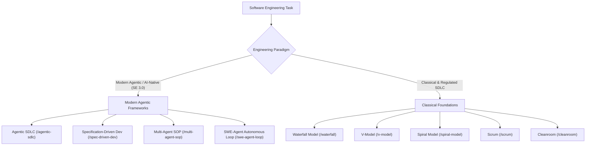
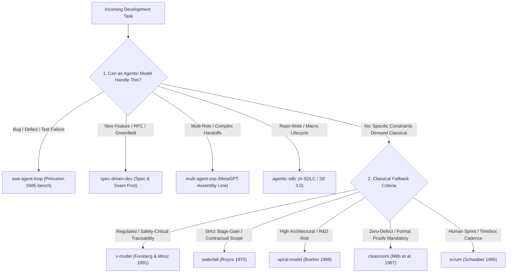

# Software Engineering & Agentic Process Models (`swe/`)

A curated repository of Software Engineering Process Models converted into executable, disciplined agent skills. Combines **modern Agentic SDLC frameworks (SE 3.0)** designed specifically for autonomous AI agents with **classical engineering models** derived from foundational peer-reviewed literature.

---

## Process Models Overview & Hierarchy



---

## Modern Agentic Frameworks (AI-Native / SE 3.0)

Contemporary software development with autonomous coding agents (Claude Code, Cursor, OpenHands, Devin) requires process models built specifically for language models, tool-use trajectories, and multi-agent coordination.

### 1. Agentic SDLC (A-SDLC / SE 3.0)
- **Skill Path:** [`swe/agentic-sdlc/SKILL.md`](agentic-sdlc/SKILL.md)
- **Primary Literature:**
  - *"Agentic AI in the Software Development Lifecycle: Architecture, Empirical Evidence, and the Reshaping of Software Engineering"* (2024).
  - *"Agentic Software Engineering: Foundational Pillars and a Research Roadmap"* (Bavishi, Roychoudhury, et al., 2024).
- **Core Concept:** Inverts control from human-written code to **agent-executed, human-steered workflows**. Features dual environments: the **Agent Command Environment (ACE)** for human steering and governance, and the **Agent Execution Environment (AEE)** for autonomous multi-step coding, tool use, and self-refinement.
- **When to Use:** Comprehensive repository-level development where autonomous agents handle end-to-end planning, coding, and verification under human oversight.

### 2. Specification-Driven Development (SDD)
- **Skill Path:** [`swe/spec-driven-dev/SKILL.md`](spec-driven-dev/SKILL.md)
- **Contemporary Origin:** Anthropic, Claude Code, GitHub Next, and AI Hero engineering patterns.
- **Core Concept:** Eliminates agent drift and hallucination by enforcing a strict sequence: **Grill Intent → Author Living Spec (`SPEC.md`) → Freeze Module Seams → Decompose into Task DAG → Execute across Concurrency Frontier → Dual-Axis Review (Standards vs. Spec)**.
- **When to Use:** New feature development, complex refactors, or greenfield systems where requirements must be completely pinned down before code synthesis begins.

### 3. Multi-Agent SOP Assembly Line
- **Skill Path:** [`swe/multi-agent-sop/SKILL.md`](multi-agent-sop/SKILL.md)
- **Primary Literature:**
  - *"MetaGPT: Meta Programming for a Multi-Agent Collaborative Framework"* — Sirui Hong et al. (ICLR 2024).
  - *"Communicative Agents for Software Development"* — Chen Qian et al. (ACL 2024 / ChatDev).
- **Core Concept:** Solves the **cascading hallucination** problem of multi-agent LLM systems by replacing free-form conversational chatter with role specialization (Product Manager, Architect, Project Manager, Engineer, QA) communicating through **Standard Operating Procedure (SOP) document artifacts**.
- **When to Use:** Multi-agent architectures, team-scale simulations, or large projects where distinct roles must collaborate without polluting each other's context windows.

### 4. SWE-Agent Autonomous Loop
- **Skill Path:** [`swe/swe-agent-loop/SKILL.md`](swe-agent-loop/SKILL.md)
- **Primary Literature:**
  - *"SWE-agent: Agent-Computer Interfaces Enable Automated Software Engineering"* — John Yang, Carlos E. Jimenez, et al. (Princeton University / NeurIPS 2024).
  - Benchmark standard: *SWE-bench / SWE-bench Verified*.
- **Core Concept:** An autonomous issue-to-patch trajectory powered by an Agent-Computer Interface (ACI): **Issue Ingestion → Author Reproduction Script (Must Go Red) → ACI Codebase Navigation & Fault Localization → Minimal Surgical Patch → Dual Verification (Repro Goes Green + Full Regression Passes)**.
- **When to Use:** Bug fixing, issue resolution, reproducing reported defects, and surgical patches in large existing codebases.

---

## Classical Foundations (Academic Lineage)

These classical models provide the theoretical foundation for verification, risk mitigation, and lifecycle management that modern agentic frameworks build upon.

### 5. Waterfall Process Model
- **Skill Path:** [`swe/waterfall/SKILL.md`](waterfall/SKILL.md)
- **Paper:** Winston W. Royce (1970). *"Managing the Development of Large Software Systems"*, IEEE WESCON.
- **When to Use:** Contractual, governmental, or audit-mandated stage gates; legacy migrations with frozen specifications; systems with strict sequential dependency.

### 6. V-Model (Vee Model)
- **Skill Path:** [`swe/v-model/SKILL.md`](v-model/SKILL.md)
- **Paper:** Kevin Forsberg & Harold Mooz (1991). *"The Relationship of System Engineering to the Project Cycle"*, NCOSE / INCOSE.
- **When to Use:** Safety-critical, regulated systems (ISO 26262 automotive, ISO 13485 medical, DO-178C avionics) requiring bidirectional requirement-to-test traceability.

### 7. Spiral Model
- **Skill Path:** [`swe/spiral-model/SKILL.md`](spiral-model/SKILL.md)
- **Paper:** Barry W. Boehm (1988). *"A Spiral Model of Software Development and Enhancement"*, IEEE Computer.
- **When to Use:** High technical risk, unproven architectures, or complex R&D where uncertainty must be retired through progressive prototyping before full capital investment.

### 8. Scrum (Empirical Agile Process)
- **Skill Path:** [`swe/scrum/SKILL.md`](scrum/SKILL.md)
- **Paper:** Ken Schwaber (1995). *"SCRUM Development Process"*, OOPSLA '95 & Jeff Sutherland.
- **When to Use:** Rapidly changing consumer web products, SaaS applications, and human-in-the-loop cross-functional team sprints.

### 9. Cleanroom Software Engineering
- **Skill Path:** [`swe/cleanroom/SKILL.md`](cleanroom/SKILL.md)
- **Paper:** Harlan D. Mills, Michael G. Dyer, & Richard C. Linger (1987). *"Cleanroom Software Engineering"*, IEEE Software.
- **When to Use:** Zero-defect tolerance environments (cryptographic kernels, satellite flight software) where developer debugging is replaced by mathematical correctness proofs.

---

## Unified Selection Matrix

| Model | Category | Primary Focus | Testing Strategy | Human Involvement | Best Suited For |
| :--- | :--- | :--- | :--- | :--- | :--- |
| **`agentic-sdlc`** | Modern Agentic | Inversion of Control | Multi-Layer Auto-Verification | Steering & Governance (ACE) | End-to-end agentic repos |
| **`spec-driven-dev`**| Modern Agentic | Spec-first deep seams | TDD per ticket frontier | Intent grilling & review | Feature additions & RFCs |
| **`multi-agent-sop`** | Modern Agentic | Hallucination control | Adversarial QA agent review | Role definition & approvals | Multi-agent collaboration |
| **`swe-agent-loop`**  | Modern Agentic | Autonomous bug-fixing | Repro Go Red ──> Go Green | Issue intake & PR merge | Bug fixes & SWE-bench tasks |
| **`waterfall`**      | Classical | Documented stage gates| End-of-cycle verification | Stage-gate approval | Fixed-scope migrations |
| **`v-model`**        | Classical | Dual-track traceability| Symmetric verification suites| Safety sign-offs | Regulated / Safety-critical |
| **`spiral-model`**   | Classical | Risk elimination | Prototype benchmarking | Quadrant 4 LCA reviews | High-uncertainty R&D |
| **`scrum`**          | Classical | Empirical adaptation | Continuous / Sprint DoD | Daily interaction & demo | Dynamic cloud/web products |
| **`cleanroom`**      | Classical | Defect prevention | Statistical reliability cert | Usage profile validation | Near-zero defect kernels |

---

## Process Model Selection Critique (Agentic-First Cascade)

When an agent initiates software development, it **must explicitly critique the incoming task requirements and declare its chosen process model before writing code**. 

The agent evaluates models using an **Agentic-First Fallback Cascade**:



### The Selection Protocol

At the start of every implementation task, the agent must output a **Process Selection Critique**:
1. **Analyze the Problem**: Evaluate requirements stability, risk profile, and testing boundaries.
2. **Prioritize Agentic (Tier 1)**: Always evaluate modern agentic frameworks first. They are purpose-built for LLM context limits, Agent-Computer Interfaces (ACIs), and automated self-refinement.
3. **Fallback to Classical (Tier 2)**: Fall back to classical models only when specific constraints mandate it (e.g. ISO safety standards, contractual stage gates, mathematical correctness proofs).
4. **Declare Intent**: Output the selected model and immediate phase before taking action:
   ```text
   Selected Process Model: [e.g. swe/spec-driven-dev]
   Justification: [Why agentic fits or why classical is required]
   Immediate Phase: [e.g. Step 1: Grilling & Intent Clarification]
   ```

---

## Agent Execution Rules

1. **Mandatory Selection Critique:** Execute the Agentic-First critique protocol on every development task.
2. **Respect the Seams:** Never write code until the specification or reproduction test is established.
3. **Local Validation:** Run `python scripts/validate-skills.py` locally before proposing changes.
